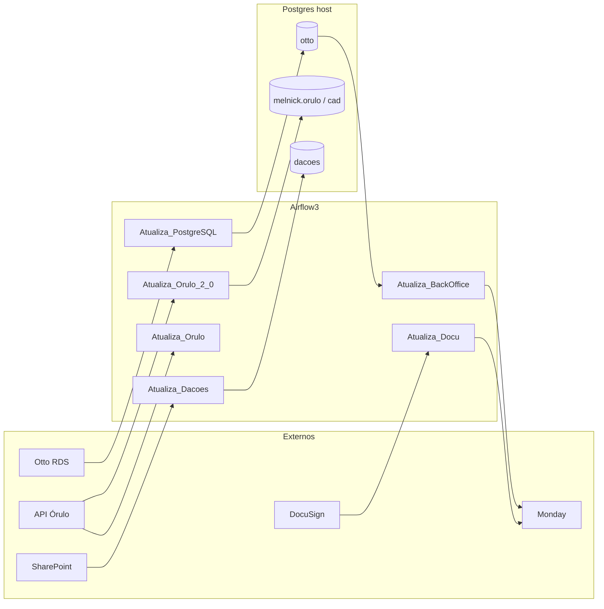

# Arquitetura — Airflow3 (Controladoria Comercial)

Manual técnico. Operação: [`README.md`](README.md). Postgres da plataforma: [`../dados/ARCHITECTURE.md`](../dados/ARCHITECTURE.md).

---

## 1. Sumário executivo

O Airflow orquestra automações batch/near-real-time da Controladoria: espelho CRM Otto, backoffice Monday+DocuSign, mercado Órulo, dações SharePoint e hygiene do Hermes Agent.

| Decisão | Escolha | Por quê |
|--------|---------|---------|
| Standalone + LocalExecutor | Um container `airflow3-standalone` | Volume de DAGs cabe em uma máquina; ops simples |
| Metadata SQLite | `data/airflow-meta/airflow.db` | Sem Postgres de metadata separado; backup = copiar o ficheiro |
| Compose só Airflow | n8n/Chatwoot em [`../n8n/`](../n8n/) | Stacks desacopladas após migração (volumes `melnick_app_*`) |
| Código em BashOperator → scripts | `Melnick-Code/Projetos/...` | Scripts já existiam; DAG = thin wrapper com `PYTHONPATH` |
| Postgres no host Windows | `host.docker.internal:5432` | Mesma plataforma documentada em `dados/` |
| Imagem com Chromium + Node | Scraping / Hermes | Selenium e toolchain Hermes no mesmo runtime |

---

## 2. Visão geral

```
                    ┌─────────────────────────────────────┐
                    │  Otto RDS (cloud)  ·  API Órulo     │
                    │  SharePoint  ·  Monday  ·  DocuSign │
                    └──────────────┬──────────────────────┘
                                   │
                    ┌──────────────▼──────────────────────┐
                    │  airflow3-standalone :8081          │
                    │  LocalExecutor · SQLite metadata    │
                    │  dags/*.py → Melnick-Code/Projetos   │
                    └──────────────┬──────────────────────┘
                                   │ host.docker.internal:5432
                    ┌──────────────▼──────────────────────┐
                    │  PostgreSQL 17 (host)               │
                    │  otto · melnick.orulo · dacoes      │
                    └─────────────────────────────────────┘
                                   │
                         Power BI / Hermes / UI dados
```

Timezone do stack: `America/Sao_Paulo`.

---

## 3. Runtime e deploy

### 3.1 Container

- Compose: [`docker-compose.yaml`](docker-compose.yaml)
- Build: [`Dockerfile`](Dockerfile) — base `airflow3-with-chromium:3.1.8-base` + Node 22.17
- Entrypoint: `pip install -r requirements.txt` → `airflow db migrate` → `airflow standalone`
- Porta host **8081** → container 8080
- Healthcheck: `GET /api/v2/version`

### 3.2 Volumes

| Host | Container | Uso |
|------|-----------|-----|
| `./dags` | `/opt/airflow/dags` | DAGs + Melnick-Code |
| `./logs` | `/opt/airflow/logs` | Task logs |
| `./plugins` | `/opt/airflow/plugins` | Plugins |
| `./data` | `/opt/airflow/data` | Dações, DocuSign, Hermes reports |
| `./data/airflow-meta/airflow.db` | `/opt/airflow/airflow.db` | Metadata |
| `./data/airflow-meta/simple_auth_manager_passwords.json.generated` | senha admin | |
| `E:/Projetos/logsOtto` | `/opt/airflow/logsOtto` | Logs Otto externos |
| Hermes AppData | `/opt/hermes` | Agent + deps guard |

### 3.3 Segurança operacional

- **Fernet key** e secret keys no compose: necessários para descriptografar Connections; rotacionar exige recriar secrets no metadata.
- Credenciais de negócio: preferir Airflow Connections + `dags/AtualizaBackoffice/.env` (não versionar).
- Simple Auth: user `admin`; senha no ficheiro gerado.
- DAGs novas entram **pausadas**.

### 3.4 Pasta legada

`chatwoot-local/` neste repo é residual da época da stack unificada — Chatwoot ativo está em [`../n8n/`](../n8n/).

---

## 4. Padrão das DAGs

Quase todas as DAGs de projeto seguem o mesmo desenho:

1. Ficheiro fino em `dags/<Nome>.py` (descoberta pelo scheduler)
2. `BashOperator` com `do_xcom_push=False` (evita 409/XCom gigante no Airflow 3)
3. `cd` para o projeto + `PYTHONPATH=.../Melnick-Code`
4. `max_active_runs=1`, `catchup=False`

Exceção: `AtualizaPostgreSQL3.py` e `Sync_Media_Otto_Imagens.py` / previsões usam `PythonOperator` (lógica no próprio módulo DAG).

Convenções ao editar: skill [`airflow-dag-patterns`](../../agents/plugins/data-engineering/skills/airflow-dag-patterns/SKILL.md).

---

## 5. Catálogo de DAGs

### 5.1 `Atualiza_PostgreSQL` — espelho Otto

| | |
|-|-|
| Ficheiro | [`dags/AtualizaPostgreSQL3.py`](dags/AtualizaPostgreSQL3.py) |
| Schedule | `50 8-18 * * 1-6` (min 50, 8h–18h, seg–sáb) |
| Source | Airflow conn **`postgres_otto`** (Otto RDS) |
| Destino | Airflow conn **`postgres`** (“Melnick” no código) → na prática o espelho local (**banco `otto`**) |

Fluxo: watermark por tabela no destino → fetch incremental no RDS → upsert + sync de enums.  
Triggers para DAGs de previsão estão **comentados** (ML offline).

Documentação de tabelas/views: [`../dados/docs/inventario-postgres.md`](../dados/docs/inventario-postgres.md) § otto.

### 5.2 `Atualiza_BackOffice` — Otto → Monday

| | |
|-|-|
| DAG | [`dags/AtualizaBackOffice.py`](dags/AtualizaBackOffice.py) |
| Script | `Melnick-Code/Projetos/AutoBackoffice/AutoBackoffice_2_0.py` |
| Schedule | a cada 20 min, 8h–18h, seg–sáb |

Busca processos/reservas/propostas no Otto, cria/atualiza contas e negócios no Monday (Relatório Comercial). Detalhe: [`.../AutoBackoffice/README.md`](dags/AtualizaBackoffice/Melnick-Code/Projetos/AutoBackoffice/README.md) e `FLUXO.md`.

### 5.3 `Atualiza_Docu` e `ContratosDocusign`

| DAG | Script | Schedule |
|-----|--------|----------|
| `Atualiza_Docu` | `AutoDocu.py` | `*/15 8-18 * * 1-6` |
| `ContratosDocusign` | `ContratosDocusign.py` | `*/5 * * * *` |

Complementam o backoffice com envelopes/assinaturas DocuSign → colunas no Monday. Dados runtime: `DOCUSIGN_DATA_PATH=/opt/airflow/data/docusign`.

### 5.4 `Atualiza_Dacoes`

| | |
|-|-|
| Tasks | `scrape_dacoes` → `load_dacoes_postgres` |
| Scripts | `Avaliação de Dações/scrape_dacoes.py`, `load_dacoes_postgres.py` |
| Schedule | 9h e 14h, seg–sex |
| Destino | banco **`dacoes`**, tabela `dacoes_itens` |
| Side effect | JSON em `data/dacoes/` (backup + Hermes) |

### 5.5 Órulo — legado vs 2.0

| DAG | Destino | Schedule | Notas |
|-----|---------|----------|-------|
| `Atualiza_Orulo` | Supabase (legado) | 8h e 13h, seg–sáb | Projeto `Projetos/Órulo` |
| `Atualiza_Orulo_2_0` | **`melnick.orulo`** | 9h e 14h, seg–sáb | Preferir para a plataforma PG; ver README do projeto |

Orulo 2.0: `ORULO_PG_DB=melnick`, `ORULO_PG_SCHEMA=orulo`, `POSTGRES_HOST=host.docker.internal`. Backup parquet opcional em `Arquivos/backup/`.

### 5.6 `Atualiza_Hermes_Deps`

Roda `Projetos/Hermes/hermes_deps_guard.py` diariamente às 07:00. Escaneia deps do Hermes Agent (`HERMES_ROOT`) e grava relatório em `data/hermes` — antecipa pedidos de atualização da TI / CVEs.

### 5.7 Previsões (inativas no schedule)

| DAG | Schedule | Estado |
|-----|----------|--------|
| `Previsao_Propostas` | `None` (era trigger) | Código presente; não disparada |
| `Prev_Propostas_Aprovacao` | `None` | Idem |
| `Previsao_Propostas_standalone.py` | — | Script fora do scheduler |

Gravam em tabelas no espelho Otto (`prev_propostas`, etc.). Histórico de debug: [`dags/Previsao_Propostas_DEBUG_HISTORICO.md`](dags/Previsao_Propostas_DEBUG_HISTORICO.md).

### 5.8 `Sync_Media_Otto_Imagens`

Manual. Lê view/tabela `media_otto`, baixa ficheiros e regista em `media_otto_imagens_sync`.

---

## 6. Código de negócio — `Melnick-Code`

```
dags/AtualizaBackoffice/Melnick-Code/
├── Módulos/           # cliente_monday, cliente_otto, cliente_orulo, logs_melnick, …
└── Projetos/
    ├── AutoBackoffice/
    ├── Avaliação de Dações/
    ├── Orulo 2.0/
    ├── Órulo/              # legado Supabase
    ├── Hermes/
    ├── Projeção de Vendas / Projeções de Venda 2.0/
    └── Expediente Único/
```

Visão geral dos módulos: [`dags/AtualizaBackoffice/Melnick-Code/README.md`](dags/AtualizaBackoffice/Melnick-Code/README.md).

---

## 7. Integrações e Connections

| Sistema | Como o Airflow fala |
|---------|---------------------|
| Otto RDS | Connection `postgres_otto` |
| Postgres local (“Melnick”) | Connection `postgres` → espelho / hub (hoje sobretudo DB `otto`; Órulo 2.0 usa env → `melnick`) |
| Monday.com | `.env` / módulos GraphQL |
| DocuSign | `.env` + `data/docusign` |
| Órulo API | client id/secret por região (env) |
| SharePoint dações | scrape (creds no projeto) |
| Hermes | volume `/opt/hermes` |
| Túnel SSH EC2 | fora do compose — `E:\Projetos\VS_Code\N8N\tunnels\` |

> Naming histórico: no código ETL, “banco Melnick” = destino local via conn `postgres`. O hub analítico canónico (`cad` / `orulo`) é o DB **`melnick`**; o espelho CRM é o DB **`otto`**. Ver inventário em `dados/`.

---

## 8. Fluxo de dados (plataforma)



---

## 9. Operação e troubleshooting

| Sintoma | Ação |
|---------|------|
| UI inacessível | `docker compose ps`; healthcheck; porta 8081 |
| DAG não aparece | Ficheiro na raiz de `dags/`; erros de parse nos logs do scheduler |
| Conn PG falha | `host.docker.internal`; Connections na UI; Postgres Windows up |
| XCom / 409 Unique constraint | Garantir `do_xcom_push=False` em BashOperators verbosos |
| Credenciais ilegíveis | Fernet key alterada — restaurar key original do compose |
| Órulo 2.0 vazio | Env `ORULO_PG_*`; DAG unpaused; logs do script |
| Pause em massa / restart | `scripts/Airflow-PauseAllDags-AndRestart.ps1` |
| Limpar metadata | `scripts/README-clean-airflow-db.md` (cuidado — destrutivo) |

---

## 10. Roadmap / dívida técnica

| Item | Notas |
|------|-------|
| Desligar ou arquivar `Atualiza_Orulo` (Supabase) | Após confiança total no 2.0 → `melnick.orulo` |
| Reativar ou remover DAGs de previsão | Triggers comentados no ETL |
| Alinhar naming Connections (`postgres` vs DB `melnick`/`otto`) | Reduz confusão em docs/agente |
| `ContratosDocusign` a cada 5 min | Avaliar carga API / custo |
| Metadata SQLite → Postgres | Só se HA/concorrência exigir |

---

## 11. Glossário

| Termo | Significado |
|-------|-------------|
| Melnick-Code | Monorepo de scripts/clientes sob `dags/AtualizaBackoffice/` |
| Conn `postgres` | Destino local no ETL (espelho CRM) |
| Conn `postgres_otto` | Otto RDS cloud |
| Thin DAG | Wrapper Bash/Python que só orquestra script existente |
| Standalone | API + scheduler + dag processor num processo Airflow 3 |
