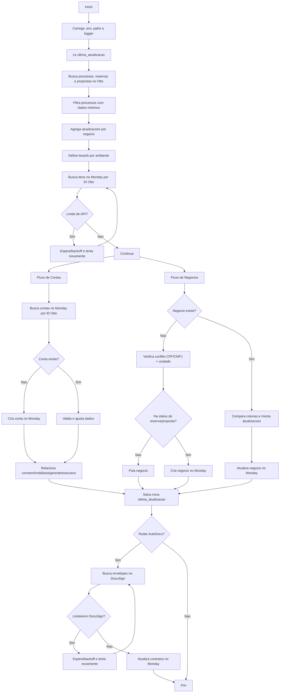

# AutoBackoffice

Automacao para sincronizar dados do Otto (CRM) com o Monday.com e manter o Relatorio Comercial atualizado. Este README explica o que o codigo faz, como executar com seguranca e onde mexer caso voce precise manter ou refatorar o projeto.

## Visao Geral

Este projeto executa as seguintes etapas, sempre na mesma ordem:
- Carrega configuracoes e variaveis de ambiente
- Busca atualizacoes no Otto (processos, reservas, propostas)
- Consolida historico de atualizacoes por negocio
- Consulta itens existentes no Monday.com
- Cria ou atualiza corretores, imobiliarias, gerentes e executivos
- Cria ou atualiza negocios no board de Relatorio Comercial
- Salva a data da ultima atualizacao bem-sucedida
- (Opcional) Executa o fluxo de contratos DocuSign

## Diagrama de Fluxo



## Estrutura do Projeto

```
AutoBackoffice/
├── AutoBackoffice.py     # Script principal (Otto -> Monday)
├── AutoDocu.py           # Atualizacao DocuSign -> Monday (contratos)
├── requirements.txt      # Dependencias do projeto
└── Dados/
    ├── ultima_atualizacao.txt     # Controle de sincronizacao Otto
    └── Docusign/
        └── ultima_atualizacao.txt # Controle de sincronizacao DocuSign
```

## Dependencias

Instale as dependencias do projeto:

```bash
pip install -r "Projetos/AutoBackoffice/requirements.txt"
```

Dependencias esperadas (podem variar conforme o ambiente):
- python-dotenv
- requests
- bibliotecas internas em Melnick Code/Módulos

## Configuracao

### Arquivo .env

O arquivo `.env` deve ficar **um nivel acima** da pasta `Melnick Code`.

```
Sua Pasta/
├── Melnick Code/
└── .env
```

### Variaveis de Ambiente

Obrigatorias para o fluxo principal (Otto -> Monday):
```
MONDAY_API_KEY=<seu_token_monday>
OTTO_DB_USER=<usuario_banco_otto>
OTTO_DB_PASSWORD=<senha_banco_otto>
AUTOBACKOFFICE_LOGS_PATH=<caminho_para_logs>
AUTOBACKOFFICE_ENVIRONMENT=<dev|prod>
```

Obrigatorias para o fluxo DocuSign (AutoDocu.py):
```
DOCU_ACCOUNT=<account_id_docusign>
DOCU_USER=<email_usuario_docusign>
DOCU_PASSWORD=<senha_usuario_docusign>
```

Observacoes:
- `AUTOBACKOFFICE_ENVIRONMENT` define quais boards do Monday sao usados (`dev` ou `prod`).
- O caminho de logs deve existir e ser gravavel.

## Execucao

### Fluxo principal (Otto -> Monday)

```bash
python Projetos/AutoBackoffice/AutoBackoffice.py
```

O script ira:
1. Ler a ultima data de atualizacao em `Dados/ultima_atualizacao.txt`
2. Buscar processos, reservas e propostas atualizados no Otto
3. Consolidar as atualizacoes por negocio
4. Consultar o Monday e identificar itens existentes
5. Criar/atualizar contas (corretores, imobiliarias, gerentes, executivos)
6. Criar/atualizar negocios no board
7. Salvar a nova data de atualizacao

### Fluxo DocuSign (contratos)

```bash
python Projetos/AutoBackoffice/AutoDocu.py
```

Esse script:
1. Busca envelopes atualizados no DocuSign
2. Atualiza status e links de contrato no Monday
3. Salva a ultima data de atualizacao em `Dados/Docusign/ultima_atualizacao.txt`

## Funcionamento Detalhado

### 1) Controle de atualizacoes

- O script usa `Dados/ultima_atualizacao.txt` para buscar apenas o que mudou.
- A data e salva como horario local (UTC-3) e convertida para UTC antes de consultar o Otto.
- Ao finalizar com sucesso, salva novamente a data da execucao.

### 2) Coleta de dados no Otto

O script busca:
- **Processos** (negocios)
- **Reservas**
- **Propostas**

Em seguida agrega reservas e propostas dentro de cada processo, ordenando por data para aplicar as regras na ordem correta. Isso evita que um status mais antigo sobrescreva uma informacao mais nova.

### 3) Busca e mapeamento no Monday

Nesta etapa o objetivo e descobrir o que ja existe no Monday, para atualizar em vez de duplicar.
- Os boards sao escolhidos por ambiente (`dev` ou `prod`).
- O script consulta:
  - Negocios pelo ID Otto
  - Corretores, imobiliarias, gerentes e executivos pelo ID de integracao
  - Possiveis conflitos por CPF/CNPJ e unidade

### 4) Regras de negocio

As atualizacoes sao aplicadas com base no historico consolidado (reservas e propostas). O script:
- Atualiza colunas de status e datas
- Preenche valores financeiros e percentuais
- Ajusta status de reserva e proposta

Os status do Otto sao convertidos para valores do Monday com dicionarios internos (ex.: `STATUS_RESERVA`, `STATUS_PROPOSTA`).

### 5) Criacao e atualizacao no Monday

- Se o negocio nao existe e ja ha status de reserva/proposta, o item e criado.
- Se o item existe, o script atualiza apenas colunas necessarias.
- Corretores, imobiliarias, gerentes e executivos sao criados quando nao existem.

### 6) Conflitos

Para evitar duplicidade, o script verifica negocios com o mesmo CPF/CNPJ e unidade. Se encontrar conflito, registra no log e segue regras internas do fluxo.

## Logs

- Os logs sao gerados pelo modulo `Módulos/logs_melnick.py`.
- O arquivo de log recebe timestamp no nome.
- Use o caminho definido em `AUTOBACKOFFICE_LOGS_PATH`.

## Dados Persistidos

- `Dados/ultima_atualizacao.txt`: controle de sincronizacao do Otto
- `Dados/Docusign/ultima_atualizacao.txt`: controle de sincronizacao do DocuSign
- Outros arquivos podem ser gerados conforme evolucao do projeto

## Manutencao e Refatoracao

### Principais pontos de extensao

- **Cliente Monday**: `Módulos/cliente_monday.py`
- **Cliente Otto**: `Módulos/cliente_otto.py`
- **Mapeamento de colunas**: `Módulos/mapeamento_dados.py`
- **Logs**: `Módulos/logs_melnick.py`

### Onde ajustar regras de negocio

- As regras estao dentro de `AutoBackoffice.py`, na secao "REGRAS DE NEGOCIO".
- Os dicionarios de status ficam proximos do topo do script.
- Evite alterar chaves do mapeamento sem atualizar `mapeamento_dados.py`.

### Cuidados comuns

- IDs de colunas do Monday sao sensiveis a mudancas nos boards.
- Datas precisam manter consistencia de timezone (UTC vs UTC-3).
- Criacao de itens no Monday pode falhar por limites de API ou permissao.

## Testes e Validacao

Este projeto nao possui testes automatizados no momento. A validacao recomendada e manual e deve seguir este roteiro:

1. **Ambiente de teste**
  - Configure `AUTOBACKOFFICE_ENVIRONMENT=dev`.
  - Use um board de desenvolvimento no Monday.

2. **Execucao a seco (primeira rodada)**
  - Rode o script com um intervalo pequeno de atualizacao.
  - Verifique no log quantos processos foram encontrados e quantos itens foram criados.

3. **Validacao de dados**
  - Confirme alguns negocios no Monday:
    - ID Otto correto
    - Nome do cliente e unidade consistentes
    - Status de reserva e proposta coerentes

4. **Consistencia de atualizacoes**
  - Rode novamente sem alterar dados no Otto.
  - O esperado e que quase nao haja atualizacoes, exceto itens realmente alterados.

5. **DocuSign (se aplicavel)**
  - Rode `AutoDocu.py`.
  - Confira se o link do contrato e o status de assinatura foram atualizados.

Se quiser testes automatizados, o primeiro passo e isolar as regras de negocio em funcoes puras e criar testes unitarios para as conversoes de status e montagem do dicionario de atualizacao.

## Troubleshooting

- **Erro de .env nao encontrado**: confirme a localizacao do arquivo.
- **Erro de credenciais**: valide tokens e usuarios.
- **Nenhuma atualizacao encontrada**: verifique `ultima_atualizacao.txt`.
- **Dados faltando**: verifique se o Otto esta retornando todos os campos.

## Roadmap Sugerido

- Validacao automatica de difs antes de atualizar o Monday
- Testes unitarios para regras de negocio
- Mecanismo de retry e backoff padronizado por tipo de operacao
- Separacao do fluxo em funcoes e classes para facilitar manutencao
