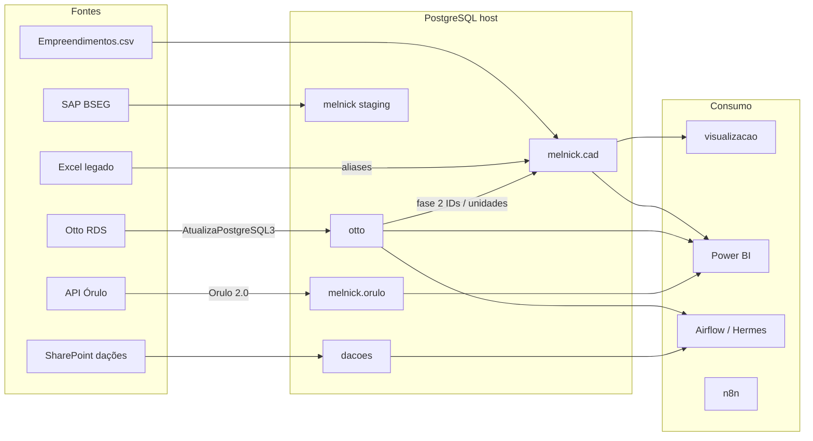

# Arquitetura de Dados — Postgres como plataforma

Manual técnico. Operação rápida: [`README.md`](README.md). Inventário de objetos: [`docs/inventario-postgres.md`](docs/inventario-postgres.md).

---

## 1. Sumário executivo

A Controladoria Comercial concentra **dados operacionais e analíticos no PostgreSQL 17 do host Windows** (`localhost:5432`). Em vez de vários silos (Excel, Supabase, SQLite, dumps soltos), o desenho atual:

| Papel | Onde |
|-------|------|
| **Cadastro canônico** (SPE → torre → unidade) | `melnick.cad` |
| **Mercado / concorrentes (Órulo)** | `melnick.orulo` |
| **CRM comercial (Otto)** | banco `otto` (+ views de negócio) |
| **Dações (SharePoint)** | banco `dacoes` |
| **Apps de automação/atendimento** | `n8n`, `chatwoot_production` |
| **Staging SAP** | `melnick.public.stage_bseg_*` (schema vazio de linhas hoje) |

O projeto [`PROJETOS/dados`](.) é o **governo** do hub `melnick` e a documentação da plataforma. Airflow e n8n **escrevem** nos bancos; Power BI / agentes / UI **leem**.

### Princípio de modelagem

> Planilha e fato **não** usam nome de empreendimento como chave.  
> Chave estável = **torre** → `cad.torres.codigo_interno` = `{cod_spe}-{cod_torre}-F{fase}` (ex. `8190-001-F1`).

Detalhe: [`docs/empreendimentos-MODEL.md`](docs/empreendimentos-MODEL.md), [`docs/governanca-nomes.md`](docs/governanca-nomes.md).

---

## 2. Visão da plataforma

```
                    Fontes externas
     ┌──────────┬──────────┬──────────┬──────────┐
     │ Otto RDS │ API Órulo│SharePoint│ CSV / SAP│
     └────┬─────┴────┬─────┴────┬─────┴────┬─────┘
          │          │          │          │
          ▼          ▼          ▼          ▼
     ┌────────────────────────────────────────────┐
     │     PostgreSQL 17 — host Windows :5432     │
     │                                            │
     │  otto          melnick           dacoes    │
     │  (CRM mirror)  ┌─ cad (master)   (itens)   │
     │                ├─ orulo (mercado)          │
     │                ├─ legacy (arquivo)         │
     │                └─ public (views+staging)   │
     │                                            │
     │  n8n  ·  chatwoot_production  ·  trade*    │
     │  sap_fi (vazio)  ·  postgres (default*)   │
     └───────────────┬────────────────────────────┘
                     │
          ┌──────────┼──────────┐
          ▼          ▼          ▼
       Power BI   Airflow    UI cadastro
                  DAGs       (visualizacao)
                  Hermes / n8n
```

\* `trade` = domínio paralelo (cripto). DB `postgres` = default do cluster (`public` limpo em 2026-08-03; dump Otto legado removido).

Containers (Airflow, n8n, Chatwoot, app `visualizacao`) acessam o host via `host.docker.internal:5432`.

---

## 3. Decisões de design

| Decisão | Escolha | Por quê |
|--------|---------|---------|
| Um Postgres no host | Serviço Windows PG 17 | Backup único; apps Docker e scripts locais compartilham; evita volume órfão pós-cisão Airflow/n8n |
| Hub analítico = DB `melnick` | Schemas `cad` / `orulo` / `legacy` | Isola cadastro canônico do espelho CRM e do raw de mercado |
| Espelho Otto = DB `otto` separado | Não misturar com `cad` | ETL `AtualizaPostgreSQL3` espelha tabelas do RDS; views PT-BR para BI; `cad` só recebe IDs via fase 2 |
| Órulo dentro de `melnick` | Schema `orulo` | Mesmo servidor do cadastro para joins futuros `cad`↔mercado; migração vindoura do Supabase (`migrate_from_supabase.py`) |
| Torre como grain canônico | `codigo_interno` | Resolve ambiguidade empreendimento vs torre/vaga/quadra |
| UUID + chave natural | PK UUID; UNIQUE em `cod_spe` / `codigo_interno` | Opacidade interna + chave legível para planilhas |
| Aliases + trgm | `cad.aliases` + `pg_trgm` / `unaccent` | Absorve grafias legadas sem duplicar SPE |
| Sem FDW (hoje) | Cross-DB via app/DAG | `dblink` está instalado em `melnick`, mas sem foreign servers; joins multi-DB ficam na aplicação ou views futuras |
| Views em `cad` + espelho `public` | `v_*` | UI/pgAdmin/BI encontram atalho em `public` sem mudar `search_path` |

Alinhamento à skill PostgreSQL do repo: `TIMESTAMPTZ` e `TEXT` no schema `cad`; dinheiro em `NUMERIC`; FKs indexadas. Dívida conhecida: `dacoes_itens` e staging SAP usam `timestamp without time zone` / tipos mistos — candidatos a normalizar na próxima evolução.

---

## 4. Banco `melnick` — hub

### 4.1 Schema `cad` (master)

| Tabela | Grain | Papel |
|--------|-------|-------|
| `sistemas_externos` | código | Catálogo (`gc`, `orulo`, `otto`, `sap`…) |
| `incorporadoras` | 1 / incorporadora | Melnick, Zulckhan… |
| `estados` / `cidades` | geo | Localização |
| `empreendimentos` | 1 / SPE (`cod_spe`) | Agrupa torres |
| `fases` | (empreendimento, nº fase) | Lançamento comercial |
| `torres` | 1 / torre | **Entidade canônica** |
| `aliases` | N nomes / entidade | Strings legadas |
| `identificadores_externos` | N IDs / entidade | Cruzamento sistemas |
| `unidades` | 1 / unidade | Sync Otto + CRUD |

DDL: [`cadastro/schema cad/01_schema_cad.sql`](cadastro/schema%20cad/01_schema_cad.sql).

Extensões: `pgcrypto`, `pg_trgm`, `unaccent`, `uuid-ossp`, `dblink`.

### 4.2 Views de consumo

Aplicar com `python scripts/apply_views.py`. Ver [`views/README.md`](views/README.md).

Principais: `v_torres_completas`, `v_empreendimentos_resumo`, `v_torres_principais`, `v_busca_cadastro`, `v_unidades_completas`, `v_torre_identificadores`, `v_torre_aliases`.

### 4.3 Schema `orulo` (mercado)

Carga: Orulo 2.0 → `orulo_db.py` (`ORULO_PG_DB=melnick`, schema `orulo`).

| Tabela | ~linhas | Conteúdo |
|--------|---------|----------|
| `buildings` | 5k | Empreendimentos Órulo |
| `units` | 252k | Unidades |
| `units_updates` | 1,0M | Histórico de atualizações |
| `images` | 102k | Mídia |
| `typologies` | 19k | Tipologias |

Join futuro com `cad`: via `identificadores_externos` sistema `orulo` / `torres.id_orulo` (ver mapeamento).

### 4.4 Schema `legacy`

Tabelas antigas de cadastro movidas de `public` (`99_archive_legacy.sql`) — consulta durante transição, sem drop.

### 4.5 Staging `public`

- `stage_bseg_completa_despesas_comercias` — SAP; join `cd_empreendimento` = `cad.empreendimentos.cod_spe`. **0 linhas** no inventário atual (estrutura pronta, carga pendente).

---

## 5. Demais bancos (mesmo servidor)

### 5.1 `otto` — espelho CRM

- **Origem:** Otto RDS (cloud), ETL Airflow `AtualizaPostgreSQL3.py` (conexão `postgres_otto` → destino local).
- **Uso:** propostas, reservas, unidades, clientes; views PT-BR (`propostas`, `reservas`, `empreendimentos`, `visitas`, …) para BI e backoffice.
- **Tabelas pesadas:** `unit_proposal_payment`, `unit`, `media`, históricos.
- **Regra:** DAGs **não** escrevem o espelho Otto em `cad`. Cruzamento Otto→`cad` é fase 2 (`identificadores_externos`, sync unidades).

### 5.2 `dacoes`

- Uma tabela: `dacoes_itens` (PK `sharepoint_id`), ~2,8k linhas.
- Pipeline: scrape SharePoint → JSON → `load_dacoes_postgres` / `dacoes_postgres.py`.
- Campo `aval_ia` (`pendente`/`avaliado`) para Hermes.

### 5.3 `n8n` e `chatwoot_production`

Estado de aplicação da stack [`../n8n/`](../n8n/). Não são modelo analítico; documentados lá. Compartilham o **mesmo** Postgres host — parte da centralização operacional.

### 5.4 `trade`

Séries Binance / previsões — fora do domínio Controladoria Comercial. Manter isolado; não misturar com `melnick`.

### 5.5 `sap_fi`

Vazio. Reservado para FI; staging atual de despesas comerciais está em `melnick.public`.

### 5.6 Banco `postgres` (default)

Default do cluster + `pgagent`. O dump Otto em `public` (~179 tabelas, ~1,2 GB) foi **removido em 2026-08-03**. Espelho CRM = DB `otto` apenas.

---

## 6. Fluxos de dados



Mapeamento coluna a coluna: [`docs/mapeamento-fontes.md`](docs/mapeamento-fontes.md).

---

## 7. Componentes deste repositório

| Componente | Função |
|------------|--------|
| `cadastro/schema cad/*.sql` | DDL/seed versionados |
| `scripts/import_empreendimentos_csv.py` | Gera seed a partir do CSV |
| `scripts/inspect_cad.py` | Valida contagens / orphans |
| `scripts/apply_views.py` | Aplica `views/*.sql` |
| `scripts/sync_otto_unidades.py` | Unidades Otto → `cad.unidades` |
| `lib/*` | Parsers/upsert (CLI + API) |
| `visualizacao/` | FastAPI + React — CRUD e Excel |

App UI: [`visualizacao/README.md`](visualizacao/README.md).

---

## 8. Roadmap (centralização)

| Fase | Entrega | Estado |
|------|---------|--------|
| **1** | Schema `cad` + seed Controladoria | Feito (~819 torres) |
| **2** | Cruzamento Otto (`integration_id` ↔ `cod_spe`) + unidades | Em andamento (~35k unidades) |
| **3** | Aliases Excel legado | Pendente |
| **4** | Fatos referenciando `cad.torres` | Pendente |
| **5** | SAP `stage_bseg` populado + joins | Estrutura ok, 0 rows |
| **6** | Limpeza dump Otto no DB `postgres` | **Feito** (2026-08-03); `sap_fi` ainda placeholder |
| **7** | Opcional: FDW/`dblink` para views cross-DB sem app | Não iniciado |

---

## 9. Operação e segurança

- Senhas só em env / Airflow Connections / `.env` local — nunca no git.
- `N8N_ENCRYPTION_KEY` / secrets Chatwoot: ver docs n8n (mesmo host PG).
- UI `visualizacao` v1 **sem auth** — localhost/rede interna.
- Collation warnings em alguns DBs (`REFRESH COLLATION VERSION`) — manutenção de cluster, não de modelo.
- Stats: após cargas grandes, `ANALYZE` nos schemas afetados (pg_stat pode mostrar `n_live_tup = 0` com tabelas cheias).

### Troubleshooting rápido

| Sintoma | Ação |
|---------|------|
| Container não conecta | `host.docker.internal:5432`; Postgres Windows no ar |
| Contagens `cad` erradas | `inspect_cad.py`; reaplicar seed na ordem |
| Órulo vazio/desatualizado | DAG Orulo 2.0; checar `orulo_db` env |
| Otto desatualizado | DAG `AtualizaPostgreSQL3`; conexão `postgres_otto` |
| Join SAP falha | Conferir se `stage_bseg` tem linhas; cast `cod_spe` |

---

## 10. Glossário

| Termo | Significado |
|-------|-------------|
| SPE / `cod_spe` | Código empreendimento GC/SAP |
| `codigo_interno` | Chave canônica da torre |
| Hub `melnick` | DB analítico (cad + orulo + staging) |
| Espelho Otto | DB `otto` local sincronizado do RDS |
| Grain | Nível de granularidade da tabela |
| Alias | Nome legado apontando para entidade `cad` |
