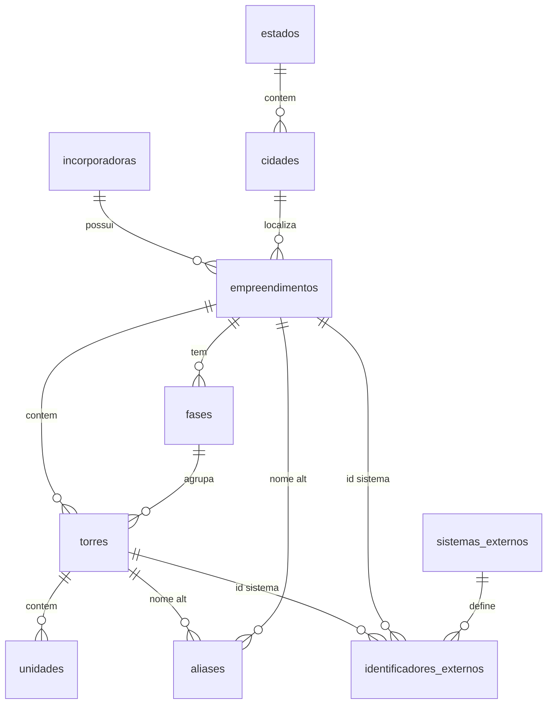

# Modelo de Dados — Empreendimentos e Torres

## Hierarquia

```
incorporadora (Melnick, Zulckhan)
  └── empreendimento (cod_spe, ex. 8190)
        └── fase (numero_fase, ex. 1)
              └── torre (codigo_interno, ex. 8190-001-F1)  ← ENTIDADE CANÔNICA
                    └── unidade (codigo_unidade, ex. 8190-001-F1-101)
```

## Chave de negócio

| Nível | Chave natural | Chave canônica |
|-------|---------------|----------------|
| Empreendimento | `cod_spe` | UUID + `cod_spe` UNIQUE |
| Torre | `(cod_spe, cod_torre, numero_fase)` | `codigo_interno` = `{spe}-{cod_torre}-F{fase}` |
| Unidade | `(cod_spe, cod_torre, fase, nome)` | `codigo_unidade` = `{codigo_interno}-{nome}` |

**Exemplo:** AG Anita Garibaldi, SPE 8190, Torre Única, código 001, Fase 1 → `8190-001-F1`

## ERD



## Tabela `cad.torres` (campos principais)

| Coluna | Descrição |
|--------|-----------|
| `codigo_interno` | Chave estável para fatos e planilhas |
| `cod_torre` | Cód. Torre do CSV (001, 00A…) |
| `nome_torre` | Torre Única, Vagas, Quadra 1… |
| `segmento` | Alto Padrão, Vaga, Comercial… |
| `estagio` | Pronto, Remanescente… |
| `tipo_empresa` | INC, URB, PERM, OPEN… |
| `principal` | Torre principal do empreendimento |
| `permutante` | Flag permuta |
| `vgv_bruto` / `vgv_liquido` | Valores gerenciais |
| `id_orulo` | ID Órulo (também em identificadores_externos) |

## Aliases e identificadores

- **`cad.aliases`**: strings usadas em planilhas legadas (`Empreendimento`, `Empreendimento + Torre`)
- **`cad.identificadores_externos`**: IDs por sistema (`gc`, `orulo`, `otto`, `sap`, …)

## Regras

1. Vagas, Lojas e Quadras são **torres**, não empreendimentos
2. Fatos referenciam `cad.torres.id` ou `codigo_interno`
3. Join SAP: `stage_bseg.cd_empreendimento` = `cad.empreendimentos.cod_spe`
4. Um empreendimento (SPE) pode ter múltiplas torres e fases

## Contagens esperadas (seed Controladoria)

- 133 empreendimentos (SPEs)
- 818 torres
- ~1636+ aliases (empreendimento + composto por torre)
